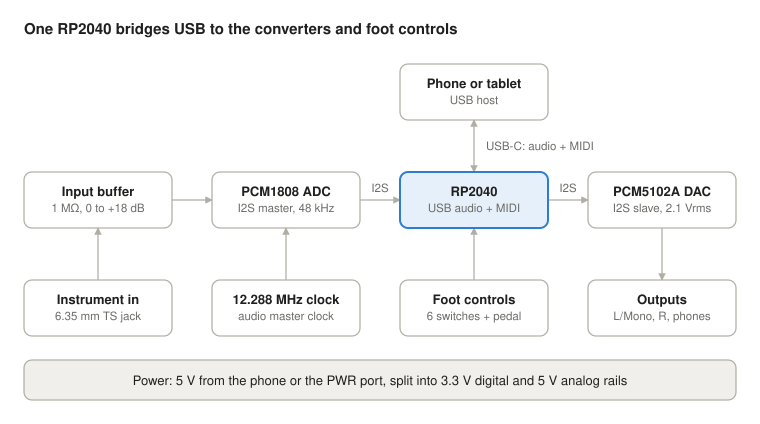

# Open-source guitar dock: hardware design

10 November 2026

## Summary

The dock is a USB-C, class-compliant device built on an RP2040, a PCM1808 ADC and a PCM5102A DAC, at roughly US$52 in parts for a one-off build. A phone or tablet sees one composite USB device: 24-bit, 48 kHz audio (1 in, 2 out) plus a MIDI port that carries the footswitches and expression pedal. No driver or companion app is needed.

| Decision | Choice | Why |
| --- | --- | --- |
| Controller | RP2040 | About $1, TinyUSB supports audio + MIDI composite devices, PIO handles I2S, large community |
| Converters | PCM1808 ADC + PCM5102A DAC | Pin-strapped (no register setup), 99 dB and 112 dB datasheet dynamic range, about $3 the pair |
| Audio clock | 12.288 MHz oscillator, ADC as I2S master | Clean converter clock; USB runs asynchronous so nothing is resampled |
| Footswitches | 6 momentary with a built-in LED ring: Bank −, Bank +, presets A to D | Covers the brief with the fewest of the most expensive part; the ring replaces a separate indicator LED and its hole |
| Expression | TRS jack for any standard pedal, plus an open printable treadle that plugs into it | A built-in treadle is the costliest mechanical part; the jack keeps the base unit cheap |
| Power | Bus-powered under 100 mA, second USB-C for external power | Works from an iPhone; external power stops the dock draining the phone |
| Licences | CERN-OHL-P v2 (hardware), MIT (firmware), KiCad sources | Permissive, so anyone can build or sell boards |

Assumptions: one mono instrument input, a fixed 48 kHz rate, and a 6.35 mm headphone output fitted as standard. Prices throughout are approximate small-quantity figures from memory; confirm them when ordering.

## Architecture

Audio runs left to right: guitar, buffer, ADC, RP2040, DAC, output jacks. The RP2040 exchanges audio and MIDI with the phone over one USB-C cable and reads the foot controls directly.

## Audio path

The input is a 1 MΩ buffered instrument stage into a 24-bit ADC, and the output is a ground-centred 2.1 Vrms stereo line stage straight from the DAC.

**Instrument input**

- 6.35 mm TS jack, AC-coupled (47 nF film), 1 MΩ bias to mid-rail, so pickups see a normal amp-style load.
- 2.2 kΩ series resistor, 47 pF to ground and a BAT54S clamp pair for RF and over-voltage protection.
- TLV9062 (rail-to-rail CMOS, 5 V): first half is the buffer with a 0 to +18 dB gain pot, second half drives the ADC through a single-pole RC filter.
- ADC full scale is about 3 Vpp at a 5 V supply, so most guitars fit at 0 dB gain. Firmware lights a clip LED near full scale.
- The second ADC channel goes to an unpopulated footprint for a second input.

**Converters and clock**

- PCM1808 strapped as I2S master at 256 fs from a 12.288 MHz oscillator, 24-bit, 48 kHz, internal high-pass on.
- PCM5102A as I2S slave on the same bit and word clocks, using its internal PLL (no separate master clock trace).
- The RP2040 is a slave on both data lines. USB audio runs asynchronous with a feedback endpoint, so the host follows the dock's clock.

**Outputs**

- Two 6.35 mm TS jacks, L/Mono and R, each through the datasheet 470 Ω + 2.2 nF filter.
- The R jack's switch contact goes to a GPIO; with R unplugged, firmware sums both channels to the L jack.
- The DAC mute pin is held by the RP2040 during plug-in and enumeration to avoid pops.
- 6.35 mm TRS headphone jack on the rear panel, driven by a cap-less headphone amp (TPA6132A2 class) with its own volume pot. This suits 16 to 80 Ω headphones; high-impedance studio models will play quieter.

Targets to verify on the first prototype: at least 95 dB A-weighted dynamic range on the input, and no more than 2 ms added by the dock in each direction.

## Controls

Every control is sent as standard USB MIDI, so any app with MIDI learn or program-change support works without dock-specific code.

| Control | Hardware | Default message |
| --- | --- | --- |
| Bank − / Bank + | Momentary SPST with LED ring; contact to GPIO, internal pull-up | Steps the bank; display and LED rings update |
| Preset A to D | Same switch type | Program Change = bank × 4 + slot (32 banks, 128 presets) |
| Expression | TRS jack, 10 kΩ to 25 kΩ pedals | Control Change 11, 0 to 127 |
| Long press, two-switch combos | Firmware only | Unassigned; available for tuner, tap tempo and similar |

Each control can be remapped to a Control Change or note. The dock also listens for Program Change from the app, so the LED rings follow presets picked on screen.

**Expression jack.** Tip and ring each go to an ADC-capable GPIO through 1 kΩ, sleeve to ground. Firmware drives one pin as the 3.3 V reference and reads the other, so both wiring conventions (wiper on tip, wiper on ring) work from a setting, with no polarity switch. Heel and toe positions are calibrated and stored; smoothing and hysteresis keep the value from chattering.

**Printable treadle.** An open 3D-printed pedal with a 10 kΩ pot plugs into the same jack. It is a separate build, so the base dock stays cheap.

**Feedback.** The LED ring in each footswitch (single colour, one GPIO and one low-side driver each, dimmed by PWM) and an optional 0.96 inch SSD1306 OLED showing bank and preset. Preset names stay on the phone screen.

## USB and power

The dock declares 100 mA and runs from the host's 5 V, with a second USB-C port for external power.

**USB**

- USB-C receptacle wired as a USB 2.0 full-speed device: 5.1 kΩ on each CC pin, USBLC6-2 ESD protection.
- Composite descriptor: USB Audio Class 2 (1 channel in, 2 out, 24-bit, 48 kHz, asynchronous) plus USB MIDI 1.0.
- Intended hosts: iPhone and iPad (USB-C direct, Lightning through the camera adapter), Android over USB-C, and macOS, Windows and Linux for desktop use.
- A build flag switches to Audio Class 1 for any host that rejects Class 2 at full speed.

**Power budget (datasheet-typical estimates, to be measured)**

| Block | Current at 5 V |
| --- | --- |
| RP2040 and flash | 30 mA |
| PCM1808 | 10 mA |
| PCM5102A | 20 mA |
| Op-amp and regulator losses | 10 mA |
| Headphone amp at moderate level | 10 mA |
| LED rings, brightness capped by PWM on bus power | 10 mA |
| OLED | 10 mA |
| Total | about 100 mA |

**Rails**

- 3.3 V digital: VBUS through a ferrite to an LDO for the RP2040.
- 5 V analog: a small boost converter to about 5.6 V, then a low-noise 5.0 V LDO for the ADC and op-amp. This keeps the analog rail steady when VBUS sags and clears switching noise from the input.
- 3.3 V analog: a second LDO for the DAC.
- 4-layer board with one solid ground plane; the input stage sits away from the boost converter and USB.

**PWR port.** A power-only USB-C input, diode-ORed with VBUS, runs the dock from a charger or power bank so it takes nothing from the phone. It does not charge the phone in this version; charging the host while it stays the data host needs a USB Power Delivery controller, which is listed as a later revision.

## Firmware

The firmware is C on the Pico SDK with TinyUSB, split across the RP2040's two cores.

- **Core 0, audio and USB.** Two PIO state machines act as I2S slave receiver and transmitter on the ADC's clocks, with DMA into ring buffers. The USB feedback value is derived from the playback buffer's fill level.
- **Core 1, controls.** Switch scan at 1 kHz with debounce, expression ADC, LED and OLED updates, MIDI in and out.
- **Latency.** One 1 ms USB frame plus about 1 ms of buffer each way. The rest of the round trip is the host's own audio buffer.
- **Configuration.** Mappings, calibration and LED brightness are set by SysEx over the MIDI port and stored in flash. A small Web MIDI page in the repo edits them from desktop or Android Chrome.
- **Updates.** Holding Bank − and Bank + at power-up reboots into the RP2040's UF2 bootloader for drag-and-drop updates. An internal BOOTSEL button is the fallback if firmware is broken.

## Mechanical

The reference enclosure is a 1590DD-size die-cast aluminium box, about 188 × 120 × 38 mm, which also shields the high-impedance input.

- **Top, front row:** preset switches A to D at about 45 mm pitch, each lit by its own LED ring.
- **Top, back row:** Bank −, the OLED, Bank +.
- **Rear panel:** instrument in, gain knob, out L/Mono, out R, phones (6.35 mm) with volume knob, expression, USB-C to the phone, USB-C power.
- **Board:** one PCB with board-mounted jacks along the rear edge, so the only hand wiring is the six four-way switch leads.
- **Device holder:** an optional printed holder sits along the rear of the top face and holds a phone or tablet at about 60 degrees, clear of the switches. It hooks over the rear edge, is held by two M4 thumbscrews into the top face, and has two legs to the floor behind the unit so a tablet cannot tip it. Two sliding side arms with foam pads grip devices from about 58 to 286 mm wide. It is modelled in `enclosure/`.
- **Alternative:** printed or laser-cut enclosure files in the repo for builders without a drill press; line the inside with copper tape around the input stage.

## Bill of materials

Parts come to about $52 for a single unit; the footswitches and enclosure are more than half of that. Figures are approximate.

| Item | Qty | Approx. cost (US$) |
| --- | --- | --- |
| Momentary footswitches with LED ring | 6 | 18.00 |
| 1590DD-size aluminium enclosure | 1 | 12.00 |
| 4-layer PCB, share of a 5-board order | 1 | 4.00 |
| 6.35 mm jacks (in, out L, out R, phones, expression) | 5 | 3.00 |
| Gain pot, knob, passives, hardware | set | 2.50 |
| Headphone amp (TPA6132A2 class), volume pot, knob | set | 2.00 |
| PCM5102A DAC | 1 | 2.00 |
| 0.96 inch SSD1306 OLED | 1 | 2.00 |
| RP2040, 2 MB flash, 12 MHz crystal | 1 | 1.80 |
| Boost converter, three LDOs, ferrites, diodes | set | 1.50 |
| PCM1808 ADC | 1 | 1.20 |
| USB-C receptacles and ESD protection | 2 | 0.80 |
| LED ring drivers (2N7002, resistors) | 6 | 0.30 |
| 12.288 MHz oscillator | 1 | 0.50 |
| TLV9062 op-amp | 1 | 0.40 |
| Total |  | about 52 |

Ways to go lower: a printed enclosure saves about $9, keyboard switches under printed foot caps save about $15 but have no LED ring, and dropping the OLED saves $2, for roughly $26.

## Build plan and risks

Start on breakout modules before committing to a PCB; the USB behaviour across hosts is the main unknown and costs under $15 to test.

1. **Breadboard proof.** A Pico board with PCM1808 and PCM5102A breakout modules. Prove the composite audio + MIDI device on iOS and Android, and measure latency and noise.
2. **Rev A board.** Full schematic in KiCad, 4-layer PCB, hand-wired switches in a drilled enclosure.
3. **Enclosure and treadle.** Drill template, printed device rest, printed expression pedal.
4. **Rev B and release.** Fix Rev A findings, publish fabrication files, BOM, firmware binaries and a build guide.

Repository layout: `hardware/` (KiCad), `firmware/`, `enclosure/`, `config-web/`, `docs/`.

**Risks**

- **Host compatibility.** Audio Class 2 on a full-speed device needs checking on each host, Windows especially. The Class 1 build flag is the fallback.
- **Input noise.** USB and boost-converter noise coupling into a 1 MΩ input is audible through high-gain amp models. Measure on Rev A before fixing the layout.
- **Lightning iPhones.** With headphones driven, the budget sits at the 100 mA limit. One ring at full brightness draws 13 to 20 mA, so LED brightness is the adjustable part, and the PWR port is the fallback.
- **Ground loops.** A dock on charger power feeding a mains-powered amp can hum. A ground-lift option on the outputs may be needed.
- **Phone charging.** Not in this version, so long sessions on bus power drain the phone.

**Open questions**

- [ ] Are four presets per bank enough, or should the top row add more switches?
- [ ] Is an external expression jack acceptable, or must the treadle be built into the chassis?
